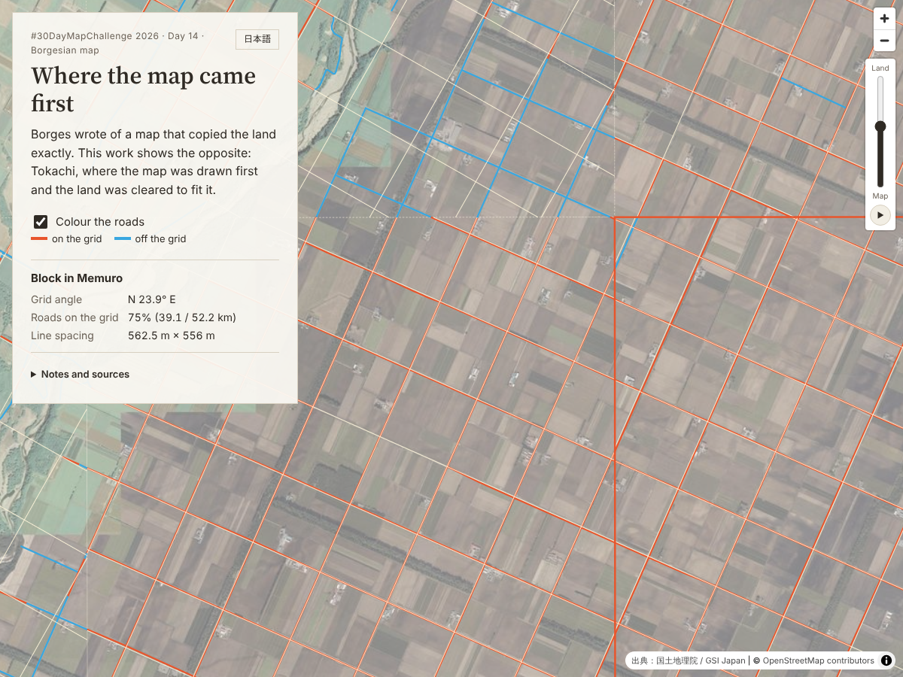

# Where the map came first — 地図が先に来た場所

#30DayMapChallenge 2026 · Day 14 · **Borgesian map**
("A map so detailed it becomes the territory.")

**公開URL:** https://shinyanakashima.github.io/30daymapchallenge-2026day14-tokachi-grid/



## 作品について

ボルヘスが描いたのは現実をそのまま写す地図でしたが、この作品ではその逆に、先に地図が作られ、それに合わせて土地が開かれた十勝を取り上げました。

明治期の北海道では、原野は入植に先立って区画されました。1897年（明治30年）の北海道国有未開地処分法のもと、300間（546m）四方の中区画を設け、それを150間×100間の小区画6つに分け、小区画1つ（5町歩）を1戸に割り当てる殖民地選定事業が行われ（1946年まで継続）、十勝の300間区画の圃場が形づくられました（農林水産省）。1883年に晩成社が帯広に入ったころは、交通の中心は川で、陸にはふみわけ道がある程度でした（北海道開発局）。

航空写真の上に、今の道路から推定した格子と、格子の上を走る道路・外れる道路を重ねて表示します。スライダーを下に動かすと、白い紙の上に格子だけが残ります。

- 英語表記が既定で、左のパネルのボタンで日本語に切り替えられます。
- 右上の＋－ボタンの下にある縦のスライダーで、「地図（格子）」と「土地（航空写真）」の見え方を切り替えます。再生ボタンを押すと、スライダーが自動で動き、白い紙の上の格子から航空写真が徐々に現れます。
- 道路は、格子の上を走るもの（橙）と外れるもの（青）に色分けして表示します。「道路を色分けする」で表示を切り替えられます。
- 区画（4km四方）をクリックすると、格子の向き、格子の上を走る道路の割合、線の間隔が出ます。

## 結果

| 項目 | 値 |
|---|---|
| 対象区画 | 4km四方 × 36区画（帯広市9、幕別町9、芽室町8、更別村5、清水町3、中札内村1、大樹町1） |
| 対象道路 | 1,792 km |
| 格子の上を走る道路の割合（全体） | **56.1%**（1,006 km） |
| 区画ごとの割合 | 18%〜98%（中央値 53%） |
| 格子の向き（真北から） | 西へ38.8°〜東へ39.4°（区画ごと。原野ごとに基線が異なるため） |
| 推定した線の間隔 | 545.5〜567.0 m（中央値 555.5 m） |
| 間隔を545.5mに固定した場合の割合 | 34.6% |
| 道路の位置をでたらめにずらして同じ当てはめをした場合（比較用） | 15.3% |

数値は `web/data/summary.json` と `web/data/tiles.geojson` に入っています。

## 格子の当てはめ方法

`scripts/fit_grid.py` で前処理し、結果を静的な GeoJSON / JSON にしています。

1. **投影:** 対象範囲の中心（東経143.12°、北緯42.76°）を原点とする横メルカトル図法（GRS80）で計算し、区画ごとに子午線収差を補正して真北からの角度にしています。
2. **区画分け:** 対象範囲（東経142.90〜143.34°、北緯42.55〜42.98°）を4,000m四方の区画に分けます。農地だけを対象にするため、次の条件をすべて満たす区画だけを使います。
   - 道路密度 2.0〜6.5 km/km²、道路延長 20km 以上
   - `highway=residential` の道路が全体の30%以下
   - 帯広・芽室・中札内・更別・大正の市街地の中心から一定距離内に入らない
3. **道路の点化:** 道路を5m間隔の点に分け、それぞれに進行方向を持たせます。
4. **向き:** 道路の向きを0〜90°に折りたたみ、長さで重み付けしたヒストグラム（0.25°刻み、σ1°で平滑化）の最頻値を格子の向きとします。
5. **位置と間隔:** 格子の2方向の線それぞれについて、線と平行な道路の長さが、線から±15m以内に最も多く入るように、線の位置（ずれ）と間隔を求めます。間隔は300間＝545.45mから570mまで0.5m刻みで探します。今の道路の中心線は546mよりわずかに広い間隔（中央値555.5m）で並んでいたため、間隔を固定すると区画の端に行くほど線がずれてしまうためです。比較のため、間隔を545.45mに固定した結果も `share_fixed_546` として出しています。
6. **判定:** 道路の点が、推定した線から **±15m以内** にあり、かつ線の向きと **15°以内** の向きで走っているとき「格子の上」と数えます。交差するだけの道路は数えません。
7. **比較値:** 道路を1本ずつでたらめな位置（0〜2,000m）にずらし、向きは保ったまま同じ当てはめをしたときの割合を `null_fit_share` として出しています。格子がなくても、当てはめの手順だけでこの程度の割合は出ます。

対象の道路は OSM の `highway` が motorway / trunk / primary / secondary / tertiary / unclassified / residential とそれぞれの `_link` です。`track`（農道の一部）と `service` は含めていません。

150間・100間の小区画の線に畑の境界や防風林が沿っているかの分析は行っていません。

## 注記

- 格子は**現在の道路から推定したもの**で、当時の区画図そのものではありません。
- 割合は、**推定した線から±15m以内、向きの差15°以内**というしきい値の中で数えたものです。しきい値を変えると割合も変わります。
- 線の間隔は道路に合わせて545.5〜570mの範囲で推定しています。
- 市町村名は区画の中心点の所在地です。

## データの取得元

| データ | 取得元 | 取得日 |
|---|---|---|
| 道路 | © OpenStreetMap contributors（ODbL）、Overpass API で取得（`scripts/fetch_osm.sh`） | 2026-11-07（OSM データ時点 2026-11-07T02:06:26Z） |
| 航空写真 | 国土地理院 シームレス空中写真（`https://cyberjapandata.gsi.go.jp/xyz/seamlessphoto/{z}/{x}/{y}.jpg`）。閲覧時に直接読み込み | 2026-11-07 確認 |
| 市町村名 | 国土地理院 逆ジオコーダー（`scripts/add_municipality.py`） | 2026-11-07 |
| 歴史 | 農林水産省「雄大な北の大地『十勝平野』の圃場と防風林」 https://www.maff.go.jp/j/nousin/sekkei/museum/m_siki/07_tokati_heiya/index.html | 2026-11-07 |
| 歴史 | 国土交通省 北海道開発局 帯広開発建設部 資料 p.143 https://www.hkd.mlit.go.jp/ob/tisui/kds/pamphlet/tabi/pdf/03-04-06-kaitaku-p143.pdf | 2026-11-07 |

出典：国土地理院（航空写真）、OpenStreetMap（ODbL）、農林水産省・北海道開発局の資料。
道路から作った `web/data/roads.geojson` と `web/data/grid.geojson` は OpenStreetMap の派生データで、ODbL に従います。

## 再現手順

```sh
pip install -r requirements.txt        # numpy, shapely, pyproj
./scripts/fetch_osm.sh                 # data/raw/osm_roads.json（約13MB、リポジトリには含めない）
python3 scripts/fit_grid.py            # web/data/*.geojson, summary.json
python3 scripts/add_municipality.py    # tiles.geojson に市町村名を追加

cd web && python3 -m http.server 8000  # http://localhost:8000/
node scripts/check_site.js             # 別ターミナルで。コンソールエラーと404の確認、docs/screenshot.png を保存
```

OSM は更新されるため、取得日が違うと数値がわずかに変わります。

## 構成

```
web/                 公開するファイル（GitHub Pages）
  index.html, style.css, app.js
  data/              前処理の結果
scripts/             前処理と表示確認
docs/                スクリーンショット
.github/workflows/   GitHub Pages へのデプロイ
```

MapLibre GL JS 4.7.1 を使っています。

## License

Code: MIT（`LICENSE`）。データはそれぞれの取得元のライセンスに従います。
